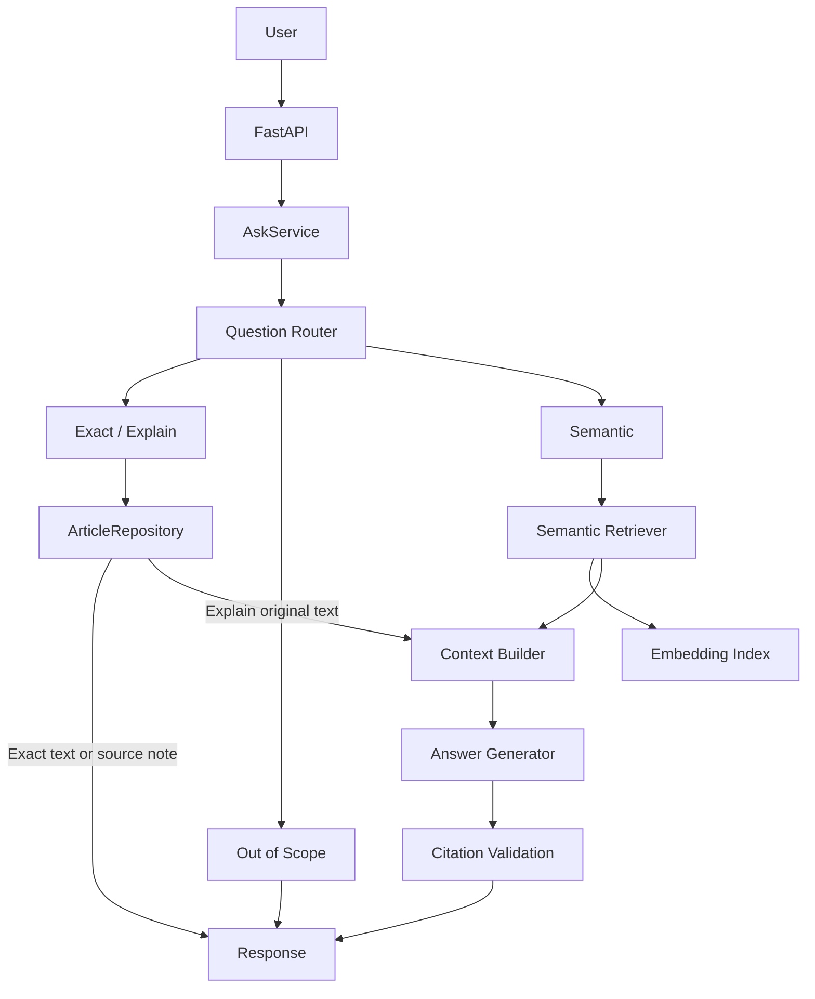
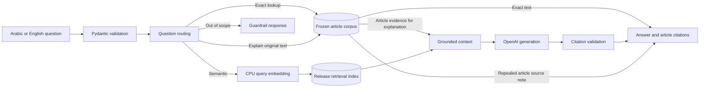
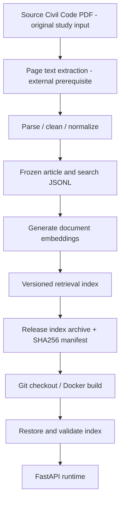
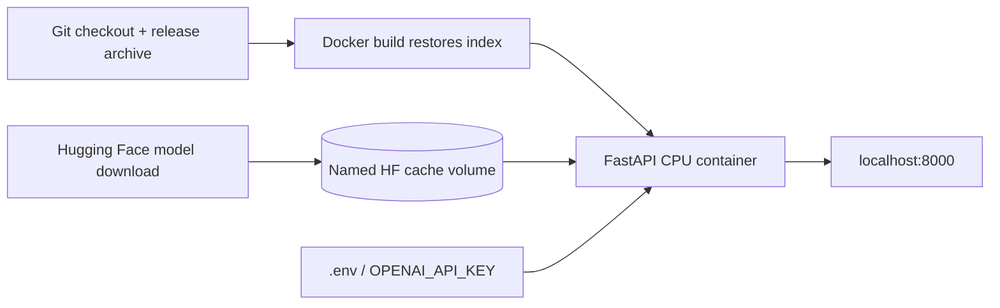
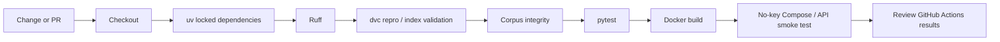

# Egyptian Civil Code RAG — MLOps Practice Project

**A bilingual Arabic/English Retrieval-Augmented Generation (RAG) learning project over a frozen educational subset of the Egyptian Civil Code.**

This repository has **two equally important purposes**:

1. **Run the application on a clean machine**: clone → configure → launch → exercise the API → verify its artifacts and tests.
2. **Learn the MLOps journey**: understand how a notebook-style RAG prototype becomes a structured, tested, reproducible, versioned, containerized, evaluated and CI-validated application. All key flows and engineering lessons remain documented below.

> **Legal disclaimer:** Educational use only, **not legal advice**. The corpus covers pages **1–18 of a 170-page PDF**; its transcription, completeness and current legal status are unverified. Articles 54–80 are represented by a source note, not original text.
>
> **Release accuracy:** Reviewed against the implementation on `release/graduation-readiness`. Historical study activities, current runnable behavior, and future work are distinguished below. Historical image sizes, Docker Hub pushes and Registry exercises are retained as the author’s learning account, not independently reproduced results. See [this README review](docs/README_REVIEW_VALIDATION.md) and the release evidence reports for the checks actually executed.

## Navigation

- [Start here: clean-machine setup](#1-start-here--clean-machine-setup)
- [Project overview and MLOps learning journey](#2-what-this-project-demonstrates)
- [Application architecture and diagrams](#4-application-architecture)
- [API and configuration](#7-runtime-configuration)
- [Tests and development](#9-local-python-development-and-tests)
- [DVC and release artifact flow](#12-dvc--artifact-versioning-and-release-reproducibility)
- [MLflow and Model Registry](#13-mlflow--experiment-tracking)
- [CI, Docker and delivery](#15-docker--reproducible-packaging)
- [Learning roadmap and knowledge gaps](#22-current-limitations--knowledge-gap-backlog)
- [Troubleshooting](#27-troubleshooting)

---

## 1. Start Here — Clean-Machine Setup

Prerequisites: Git, curl (or the PowerShell HTTP example below), an internet connection, Docker Engine/Desktop running in Linux-container mode, and Docker Compose with `--wait` support. The primary target is Linux x86_64; Windows uses Docker Desktop/WSL2. macOS Linux-container execution has not been validated. CPU only; no GPU, CUDA, AWS, Qdrant or Langfuse account is required. Allow disk space for the Python/PyTorch image and the multilingual model cache; first-download time and peak RAM depend on the machine and have not been benchmarked.

Clone the release branch explicitly (the default branch may contain an older delivery):

```sh
git clone --branch release/graduation-readiness --single-branch https://github.com/MahmoudAmgad88/civil-code-rag-mlops.git
cd civil-code-rag-mlops
```

For an existing clone, select the release branch after preserving any local edits. Run all commands below from the repository root. **If `.env` already exists, keep it and skip the copy command.** For a fresh checkout, the three primary commands are:

```sh
cp .env.example .env
docker compose up --build -d --wait --wait-timeout 180
curl http://127.0.0.1:8000/health
```

`cp` also works in PowerShell. Use `curl.exe` in Windows PowerShell if `curl` is an alias. Compose requires the `.env` file even when its key is blank. Before startup, optionally put an evaluator-provided `OPENAI_API_KEY` in `.env` to enable generated answers. Leaving it blank enables no-key review.

Expected health response:

```json
{"status":"ok","indexed_document_count":268,"corpus_record_count":162}
```

The image restores and validates the versioned index during build. There is no developer index mount or DVC remote prerequisite. Health checks inspect the corpus/index but never download a model or contact OpenAI. The first semantic request downloads the pinned Hugging Face model into a new named cache volume. Expect that request to be slower; download duration has not been measured. Package/image downloads need internet during build. After setup, health and exact lookup work offline; generation needs internet and OpenAI access.

Only API port 8000 is published, bound to `127.0.0.1`. Optional MLflow uses port 5000.

---

## 2. What This Project Demonstrates

```text
Code
  ↓
Reproducible Environment
  ↓
Testing + Code Quality
  ↓
Data / Artifact Versioning
  ↓
Experiment Tracking
  ↓
Model Registry Practice
  ↓
API Serving
  ↓
Containerization
  ↓
Continuous Integration
  ↓
Repeatable Delivery
```

The application supports:

- Arabic and English questions
- Exact article lookup
- Explanation of a named article
- Semantic retrieval
- Grounded LLM answers
- Citation validation
- Out-of-scope rejection
- Repealed-article source-note handling
- Language-isolated retrieval

The goal is not to maximize RAG quality at this stage. The goal is to understand how an ML/GenAI system moves toward reliable production operation.

---

## 3. Frozen MVP Scope

| Item | Value |
|---|---:|
| Civil Code articles | 160 |
| Additional promulgation records | 2 |
| Total corpus records | 162 |
| Retrieval/search records | 268 |
| Languages | Arabic + English |
| Repealed range represented by source note | Articles 54–80 |
| Current PDF coverage | Pages 1–18 of 170 |
| Embedding dimension | 384 |

The corpus manifest stores lineage and integrity metadata such as record counts, article coverage, languages, parser version, repealed ranges, and source hashes.

The complete 170-page extraction is intentionally outside the current MLOps scope.

---

## 4. Application Architecture



Package responsibilities (the first six paths are relative to `src/civil_code_rag/`; `pipelines/` and `tests/` are at the repository root):

- `core/` — routing, language detection, scope rules, citation rules
- `repositories/` — frozen corpus access
- `retrieval/` — semantic search and context construction
- `generation/` — OpenAI request handling
- `services/` — business logic through `AskService`
- `api/` — FastAPI routes, validation, schemas, lifecycle, and error mapping
- `pipelines/` — offline parsing, corpus, index, manifest, and evaluation workflows
- `tests/` — unit, API, integration, regression, and integrity coverage

### Lazy heavy-resource initialization

The embedding model and OpenAI client initialize only when required by their routes. The retriever lazily loads its own index, but `/health` separately reads the small NumPy index and corpus on each request to validate them. Health is therefore a local-data readiness check, not a process-only liveness check.

Therefore these paths do not require model loading or an OpenAI key:

- application import
- `/health`
- exact article lookup
- out-of-scope rejection
- repealed-article source-note responses

---

### End-to-end request journey (why the components exist)



**Concept → production connection:** the API validates input; `AskService` coordinates routing; the corpus and index provide retrieval evidence; generation uses an external OpenAI provider only when necessary; citation validation guards the returned answer. This separation makes deterministic tests possible without a live LLM key.

### Offline artifact and release flow



**Release boundary:** the source PDF is **not included in the distributed checkout**. The current clean-machine path restores the exact versioned index from the Git-tracked archive; it does **not** rerun initial PDF extraction. Rebuilding embeddings from scratch is a separate intentional experiment and may not reproduce byte-identical floating-point results on different platforms.

---

## 5. Project Structure

```text
civil-code-rag-mlops/
├── .dvc/                         # DVC project metadata
├── .github/workflows/           # CI checks
├── artifacts/
│   ├── retrieval-index.zip      # Git-tracked release index archive
│   └── retrieval-index.json     # checksums and provenance
├── data/
│   ├── processed/               # frozen corpus / search records
│   ├── index/                   # generated by restoration; not Git-tracked
│   └── index.dvc                # original DVC index pointer, still preserved
├── docs/                         # readiness, clean-machine evidence, release notes
├── eval/                         # retrieval questions
├── outputs/                      # generated index-validation reports
├── pipelines/                    # offline data, index and evaluation scripts
├── src/civil_code_rag/
│   ├── api/                      # FastAPI, Pydantic schemas, dependencies
│   ├── core/                     # routing, language and citation rules
│   ├── generation/               # OpenAI generation boundary
│   ├── repositories/             # article corpus access
│   ├── retrieval/                # search and context building
│   ├── services/                 # AskService application logic
│   ├── release_artifact.py       # restore/validate release index
│   └── config.py
├── tests/
├── .env.example                  # names and defaults, no credentials
├── Dockerfile
├── docker-compose.yml
├── dvc.yaml                       # release artifact restoration/validation stage
├── dvc.lock                       # stage dependency and report hashes
├── pyproject.toml
├── uv.lock
└── README.md
```

The directory map matches the release source tree. `outputs/` and the restored `data/index/` are generated, ignored paths; they need not exist in a fresh clone. `.env` is created from `.env.example`. The source PDF, page-text extraction, model cache and MLflow backend are not distributed.

---

## 6. Technology Stack

### Application

- Python 3.12 for the documented release (the package declares `requires-python = ">=3.11"`; Python 3.11 is not the validated delivery target)
- FastAPI
- Pydantic
- OpenAI Responses API
- Sentence Transformers
- PyTorch CPU
- NumPy

### MLOps / Engineering

- `uv` — dependency and environment management
- Git / GitHub — source-code versioning
- `pytest` — automated testing
- Ruff — linting and code quality
- Docker — application packaging
- Docker Hub — container registry practice
- DVC — retrieval-index artifact versioning
- MLflow — experiment tracking and Model Registry practice
- GitHub Actions — Continuous Integration

---

### Clean-machine release addition

The release distributes a small checked-in **index archive and provenance manifest** so reviewers do not need access to the developer's DVC remote. This is a deliberate reproducibility choice for the MVP, not a replacement for DVC on larger datasets.

---

## 7. Runtime Configuration

| Variable | Default / requirement |
|---|---|
| `OPENAI_API_KEY` | Blank is allowed; required for generated answers. Standard OpenAI key supplied by the evaluator. |
| `CIVIL_CODE_RAG_CORPUS_PATH` | `data/processed/articles.jsonl` locally |
| `CIVIL_CODE_RAG_INDEX_DIR` | `data/index` locally |
| `CIVIL_CODE_RAG_EMBEDDING_MODEL` | `intfloat/multilingual-e5-small` |
| `CIVIL_CODE_RAG_LLM_MODEL` | `gpt-4.1-mini`; key must have access to this model |

Local Python reads `.env` in the current working directory; process environment values take priority. Prefixed settings are cached for the process lifetime. Without path overrides, the defaults are derived from the source checkout; the relative path values in `.env.example` assume you run from its root. Compose reads `.env` and sets the two data paths to their absolute container locations. Keep keys out of Git; `.env` is ignored and excluded from the Docker build context. Do not paste `docker compose config` output when using a real key; use `config --quiet` for validation.

The release index is tied to embedding revision `614241f622f53c4eeff9890bdc4f31cfecc418b3`. Serving rejects another embedding model to prevent incompatible retrieval. A different model requires a separately rebuilt, evaluated and versioned index and an intentional serving implementation change: setting the variable alone is rejected. The legacy offline pipeline helpers use fixed repository paths rather than the four prefixed runtime settings. Index building, search and evaluation pin the release model revision; `pipelines/check_token_lengths.py` uses the model name without a revision pin, so its historical token check can follow the Hub default.

---

## 8. API Examples and Contract

Interactive schemas: `http://127.0.0.1:8000/docs`.

```sh
curl -X POST http://127.0.0.1:8000/ask -H "Content-Type: application/json" -d '{"question":"What does Article 91 say?"}'
curl -X POST http://127.0.0.1:8000/ask -H "Content-Type: application/json" -d '{"question":"ما نص المادة ٩١؟"}'
curl -X POST http://127.0.0.1:8000/ask -H "Content-Type: application/json" -d '{"question":"Explain Article 91"}'
curl -X POST http://127.0.0.1:8000/ask -H "Content-Type: application/json" -d '{"question":"When does an expression of intent take effect?"}'
```

The inline curl examples above target POSIX shells on Linux/macOS. Git Bash on Windows can corrupt inline Arabic arguments when invoking Windows curl; do not interpret that as an Arabic routing result. On Windows PowerShell, use `Invoke-RestMethod` with a UTF-8 body to avoid native-command quoting/encoding differences:

```powershell
$body = [Text.Encoding]::UTF8.GetBytes('{"question":"ما نص المادة ٩١؟"}')
Invoke-RestMethod http://127.0.0.1:8000/ask -Method Post -ContentType 'application/json; charset=utf-8' -Body $body
```

Exact-response fields (answer shortened here):

```json
{"route":"exact","language":"en","article_id":"CC-91","cited_article_ids":["CC-91"],"answer":"A declaration of intention ...","source_note":null,"verified_status":"unverified","pdf_pages":[8,9]}
```

This is a schema illustration, not a complete verbatim article; the shortened `answer` is not an expected string to assert against. Page metadata comes from the frozen corpus. Exact responses retain the original fields and add `cited_article_ids`. Explanations and semantic responses already expose that citation list. A repealed exact lookup returns `answer: null`, the source note, and an empty citation list; explanation requests for those records also return the source note without calling OpenAI.

| Request | Key/model needed | Behavior |
|---|---|---|
| Health | Neither | 200 + data counts; 503 if local data is unavailable/invalid |
| Exact article in Arabic/English | Neither | Original corpus text or source note |
| Explicit out-of-scope request | Neither | Rejection response |
| Empty/whitespace question | Neither | HTTP 422 |
| Article outside corpus | Neither | HTTP 404 |
| Explain available original text | OpenAI key | Grounded generation, validated citations |
| Semantic `/ask` question | OpenAI key + CPU embedding model | Language-isolated retrieval and grounded generation |

Without a key, LLM-dependent routes return HTTP 503 with `{"detail":"OPENAI_API_KEY is required for generated answers."}` before model loading. OpenAI failures return a sanitized 503; invalid generated citations return 502. API routes use synchronous handlers, so FastAPI runs blocking model/HTTP work in its thread pool. Citation validation rejects recognized `[CC-n]` / `[PROM-n]` IDs absent from the supplied context. It does not enforce a nonempty citation list, assess whether each claim is supported, or verify current legal status. Language detection is a simple Arabic-character rule, and out-of-scope rejection handles explicit patterns rather than a general classifier. This MVP is not tuned for concurrent production traffic.

### API design lesson

`Pydantic` declares input/output contracts; `FastAPI` handles HTTP and lifecycle concerns; `AskService` owns RAG decisions. The original repo includes a `route` discriminator so reviewers can tell whether a question used exact lookup, an explanation, semantic retrieval or an out-of-scope guardrail. **Do not confuse an exact article response with an LLM-generated answer.**

---

## 9. Local Python Development and Tests

Install Python 3.12 and uv 0.11.7. Path handling supports Windows/Linux; the existing Python 3.12.9 environment passed tests. A fresh Windows Python 3.12.13 pytest run hit an OpenSSL runtime error, so Docker is the validated clean-machine path. From the checkout, after copying `.env.example` as above:

```sh
uv sync --locked --extra dev --extra embeddings --python 3.12
uv run --locked python -m civil_code_rag.release_artifact
uv run --locked uvicorn civil_code_rag.api.main:app --host 127.0.0.1 --port 8000
```

No key is required for deterministic checks:

```sh
uv run --locked --extra dev ruff check .
uv run --locked python -m pipelines.validate_corpus
uv run --locked --extra dev python -m pytest tests -q
uv run --locked --extra dev python -m pipelines.smoke_api --expect-no-key
```

The last command requires the running no-key API. Omit `--expect-no-key` if using a real key. `--live-generation` makes one paid semantic request and should only be used intentionally. Unit/integration tests mock generation and do not call OpenAI. Model installation is optional for health/exact-only local review: `uv sync --locked --extra dev --python 3.12` installs the needed local packages without Sentence Transformers/PyTorch. **Restore the index with `uv run --locked python -m civil_code_rag.release_artifact` before running pytest**; its runtime-integrity test fails when the index is absent. Start Uvicorn in one terminal and run HTTP smoke commands in a second. Docker startup itself does not install a host uv/Python environment.

---

## 10. Testing Strategy and Learning Flow

The project uses multiple testing levels:

```text
Unit Tests
  ↓
API / Contract Tests
  ↓
Integration Tests
  ↓
Runtime Integrity Tests
  ↓
Manual E2E Smoke Test
```

Run all tests:

```bash
uv run --locked --extra dev python -m pytest tests -q
```

Run Ruff:

```bash
uv run --locked --extra dev ruff check .
```

### Current integration coverage

`tests/test_api.py` exercises:

```text
HTTP Request
→ FastAPI
→ AskService
→ Real ArticleRepository
→ Frozen Corpus
```

while expensive/external dependencies are controlled with mocks where appropriate.

`tests/test_context_builder_integration.py` exercises:

```text
Real Corpus
→ ArticleRepository
→ Context Builder
```

`tests/test_answer_generator_integration.py` validates the OpenAI request contract using a fake client, so no network call is required.

### Manual E2E smoke path

```text
FastAPI
→ Retriever
→ Embedding Model
→ DVC-managed Index
→ Context Builder
→ OpenAI
→ Citation Validation
→ Final Response
```

This gives a practical distinction:

- **Unit test** — one isolated component
- **Integration test** — multiple real components working together
- **E2E test** — the complete user path including runtime/external dependencies

---

### Deterministic vs live checks

The release `pipelines.smoke_api` provides an explicit **no-key** mode. Normal pytest tests do not need paid OpenAI requests; a deliberate `--live-generation` path is available for an authorized evaluator with API quota. Verify that the model cache can download on the first semantic request.

Do not claim a full live E2E test was exercised merely because the unit tests passed.

---

## 11. Offline Data and Index Pipeline — Learning Reference

**Historical development pipeline (not clean-machine prerequisites):** run from the repository root only when intentionally reprocessing data. `pipelines/parse_arabic.py` and `pipelines/parse_english.py` consume `data/raw_pages/pypdf/page_001.txt` through `page_018.txt`, not the PDF directly. Those ignored page-text inputs must first be extracted from your source; no tracked PDF-to-page-text extraction command is supplied. `pipelines/build_manifest.py` additionally requires `data/Egyptian Civil Code.pdf`. Neither the PDF nor the raw page-text files accompanies a clean clone. Install the dev/embedding extras as in Section 9, and preserve the release data before running these commands:

```bash
uv run --locked python -m pipelines.parse_arabic
uv run --locked python -m pipelines.parse_english
uv run --locked python -m pipelines.pair_articles
uv run --locked python -m pipelines.validate_corpus
uv run --locked python -m pipelines.build_search_records
uv run --locked --extra embeddings python -m pipelines.check_token_lengths
uv run --locked --extra embeddings python -m pipelines.build_embedding_index
uv run --locked python -m pipelines.build_manifest
uv run --locked --extra dev --extra embeddings python -m pipelines.evaluate_retrieval
```

Do not rebuild the frozen corpus or index casually.

A data or embedding change should be treated as a versioned MLOps change: rebuild → validate → evaluate → version.

---

**Current reviewer path:** use the release artifact restoration (`python -m civil_code_rag.release_artifact`) or `dvc repro` instead. The source PDF is **not** part of the public release artifact; this list is a learning record of how the frozen corpus was originally created, not a guarantee that extraction can execute from a fresh clone. The already committed JSONL data, versioned release archive and provenance metadata are the runtime inputs.

---

## 12. DVC — Artifact Versioning and Release Reproducibility

**Core concept:** Git versions source and small metadata; DVC tracks data/artifact lineage and reproducible stages. For this small graduation release, reviewers should not need an inaccessible local DVC remote.

The chosen distribution is a 415,196-byte Git-tracked archive, `artifacts/retrieval-index.zip`, with SHA-256 checksums, frozen input hashes and model provenance in `artifacts/retrieval-index.json`. This small MVP artifact avoids external storage credentials. The trade-off is Git history growth if many index versions are committed; larger future corpora should use shared artifact storage.

```sh
uv run --locked --extra dev dvc repro
uv run --locked --extra dev dvc status
```

`dvc.yaml` restores the index from the archive, validates checksums, vector normalization, finite values, source IDs, languages, dimensions and record order, and writes `outputs/index-validation.json`. Dependencies are the archive/manifest, frozen corpus/search records, restoration code/settings and lockfile. The original `data/index.dvc` remains intact; the pipeline tracks the validation report rather than declaring duplicate ownership of `data/index/`, which belongs to the original pointer. Its report has `cache: false` and the stage intentionally runs on every reproduction to check missing/corrupt runtime files. `dvc status` therefore reports `always changed` for that stage; this is expected.

No `dvc pull` is needed. The previous local remote in developer-only `.dvc/config.local` is not shared and is not used by this procedure. Restoration refuses to overwrite a different existing index; preserve that index and use `--output` with a new directory for comparison. To test a fresh destination:

```sh
uv run --locked python -m civil_code_rag.release_artifact --output outputs/reviewer-index
```

Git attributes preserve the frozen JSONL CRLF bytes across operating systems so source hashes match. The source PDF is not bundled; reconstructing the original PDF extraction requires that external source and is outside clean-machine startup. The frozen corpus and paired/search records are in Git. To intentionally regenerate vectors rather than restore the exact release bytes, run `uv run --locked python -m pipelines.build_embedding_index` with embedding dependencies installed. CPU numerical differences across library/platform versions may prevent byte-identical regeneration; archive restoration is byte-identical.

### Historical DVC exercise — why we used it

In the original study phase we practiced:

```text
Git: data/index.dvc pointer
       ↓
DVC cache: index object bytes
       ↓
dvc push → local filesystem remote
       ↓
remove local copy → dvc pull → restore artifact
```

That exercise demonstrated artifact versioning, but the developer-local remote did **not** make a clean GitHub clone reproducible. The new release uses a Git-tracked **415,196-byte archive** and SHA-256 manifest. This changes the reviewer path, not the underlying learning about DVC.

### DVC migration: before vs now

| Concern | Earlier learning environment | Current release for a reviewer |
|---|---|---|
| Artifact storage | DVC remote on developer machine | Versioned archive tracked in Git |
| Restore | `dvc pull` from local remote | Docker build / release artifact helper |
| Reproduction | DVC object restore only | `dvc repro` validates release artifact |
| CI access | Local remote inaccessible | Release artifact available in checkout |
| Scaling later | Local practice | Shared object store / remote recommended |

**Key distinction:** `dvc repro` in this release validates and restores the **frozen release index**; it does not run the original PDF extraction process end-to-end. The original `data/index.dvc` pointer remains, but `dvc pull` is **not** a valid reviewer setup requirement.

---

## 13. MLflow — Experiment Tracking

MLflow tracks retrieval evaluation experiments.

Start MLflow:

```bash
uv run --locked --extra dev mlflow server --host 127.0.0.1 --port 5000
```

Run retrieval evaluation:

```bash
uv run --locked --extra dev --extra embeddings python -m pipelines.evaluate_retrieval
```

Tracked information includes:

**Parameters**

- `top_k`
- embedding model
- evaluation dataset
- question count

**Metrics**

- Recall@K
- Mean Reciprocal Rank (MRR)
- mean retrieval latency

**Reproducibility metadata**

- Git commit
- Git dirty status

**Artifacts**

- evaluation summary JSON

The important lesson is that an experiment should connect:

```text
Parameters + Metrics + Artifacts + Source-Code State
```

---

### Release instructions and actual evidence boundary

Existing evaluation uses `eval/dev_questions.jsonl`, Recall@K, MRR and retrieval latency, with Git revision/dirty status, parameters and summary artifacts logged to MLflow. In one terminal:

```sh
uv run --locked --extra dev mlflow server --host 127.0.0.1 --port 5000
```

In another:

```sh
uv run --locked --extra dev --extra embeddings python -m pipelines.evaluate_retrieval
```

Open `http://127.0.0.1:5000` and select `civil-code-rag-retrieval`. The current script evaluates `top_k=6`, loads `data/index/`, and hardcodes the MLflow tracking URI to `http://127.0.0.1:5000`; keep that server running before invoking evaluation. Evaluation uses embeddings, not OpenAI generation, and needs no OpenAI key. It logs per-language Recall@K, MRR and mean retrieval latency; it does not log RAGAS scores, chunking comparisons or an embedding revision parameter. Historical runs/Registry state are local artifacts and are not included in a clone. No five-run comparison, RAGAS scores, quality threshold or Registry promotion is claimed for this release. See the gap report for rubric items requiring further work.

---

## 14. MLflow Model Registry Practice

In the author’s reported historical study, the embedding model was registered in MLflow to practice model lifecycle concepts (there is no checked-in registration/promotion command or portable Registry export):

```text
Register
→ Version
→ Champion
→ Challenger
→ Promote
→ Rollback
```

The project used the same embedding model during part of this workflow because the goal was to practice lifecycle mechanics.

The concept is:

```text
Versioned model/artifact
→ explicit approved version
→ controlled promotion
→ reversible rollback
```

---

**Evidence boundary:** this is a *historical study exercise*. Registry records and experiment runs stored only in a local MLflow backend do not accompany the Git clone. The clean-machine release should not claim that a reviewer will see previously registered versions or five logged evaluation runs without packaged evidence.

---

## 15. Docker — Reproducible Packaging

Build:

```bash
docker build -t civil-code-rag:local .
```

The project is CPU-only.

### Docker optimization lesson

An early image reached approximately **18.5 GB** because PyTorch resolved CUDA/NVIDIA dependencies that were unnecessary for this workload.

The dependency configuration was changed to CPU-only PyTorch and the build was improved with cache-aware installation.

The resulting development image was reduced to approximately **1.8 GB**.

The exact size can vary, but the engineering lesson is:

```text
CPU workload
→ CPU-only dependencies
→ smaller image
→ faster transfer/startup
→ lower storage overhead
```

### Release runtime architecture (current)

The earlier development runtime **bind-mounted** `data/index` from the developer machine. **Do not use that old command for clean-machine grading.** The current release Docker image restores and validates `artifacts/retrieval-index.zip` during its build. Compose publishes only `127.0.0.1:8000`; the first semantic question can download the pinned Hugging Face model into a persistent named cache volume. The OpenAI key is injected at runtime through `.env`.



```sh
docker compose up --build -d --wait --wait-timeout 180
docker compose down
```

**Why this changed:** a reviewer can now run the project without copying an index directory from the author's computer. The early image reduction from ~18.5 GB to ~1.8 GB is a *historical development observation*, not a measured guarantee about the final release image size.

---

## 16. Continuous Integration — GitHub Actions

GitHub Actions provides an automated quality gate:



**Release workflow (verified in `.github/workflows/ci.yml`):**

```text
Checkout → locked uv install → Ruff → DVC release validation →
Corpus checks → pytest → Docker build → no-key Compose/API smoke checks
```

### Why CI does not use a live OpenAI key

Normal automated tests use fakes/mocks and avoid real OpenAI calls.

That keeps CI:

- deterministic
- faster
- cheaper
- independent of external API availability
- safer because normal CI does not require an LLM secret

### Release improvement over the historical CI

The old workflow could skip an artifact test because the remote was local-only. The current release bundles a small index archive so index validation is possible on CI without `dvc pull` or private storage. This does not prove a remote GitHub Actions run passed; inspect the actual checks on the release commit.

The workflow triggers on pushes to `main`, `feature/**` and `release/**`, pull requests targeting `main`, and manual dispatch. It pins uv 0.11.7 and installs Python 3.12. There is no Docker registry push or live-paid-OpenAI stage in this workflow. Historical Docker Hub publishing is not automated release deployment.

---

## 17. Git Delivery Workflow

Development is performed on a feature branch and delivered through a pull request:

```text
feature/day1-package-refactor
→ Push
→ Pull Request
→ GitHub Actions
→ Green Checks
→ Merge to main
→ Release Tag
```

**Historical release-tag example (study reference, not startup commands):** `v1.0.0` already exists in the inspected repository. These commands describe how a tag can be published; do not rerun them for the current preparation branch or overwrite the existing tag.

```text
git tag -a v1.0.0 -m "Civil Code RAG MLOps MVP v1.0.0"
git push origin v1.0.0
```

Tagging creates an identifiable release point instead of relying only on the latest commit. Inspect the existing tag without changing it:

```sh
git tag --list v1.0.0
git show --no-patch v1.0.0
```

The current delivery is `release/graduation-readiness` / [draft PR #4](https://github.com/MahmoudAmgad88/civil-code-rag-mlops/pull/4); an existing historical tag is not evidence that this branch was merged or newly tagged.

---

## 18. Reproducibility Strategy

Reproducibility is provided by several layers, not one tool.

| Concern | Mechanism |
|---|---|
| Source code | Git commit |
| Python dependencies | `pyproject.toml` + `uv.lock` |
| Corpus lineage | corpus manifest |
| Data integrity | hashes + validation |
| Retrieval index | DVC metadata + Git-tracked release archive + SHA-256 verification |
| Experiments | MLflow |
| Experiment source state | Git commit logged in MLflow |
| Runtime packaging | Docker |
| Automated validation | GitHub Actions |
| Release identity | Release branch/commit and draft PR; `v1.0.0` is an existing historical tag |

Core principle:

> A result is only useful if we can identify which code, data, configuration, dependencies, and artifact versions produced it.

---

### What a fresh clone can reproduce

| Capability | On clean checkout? | Notes |
|---|---|---|
| Health and exact lookup | Yes (after Docker build) | No OpenAI key required |
| Same release index bytes | Yes | Restore from Git-tracked archive |
| Semantic retrieval through `/ask` | Conditional | Route requires an OpenAI key before loading the CPU model; first model download needs internet |
| Offline retrieval evaluation | Yes after local setup and model download | Requires restored index, embedding/dev extras and the local MLflow server; no OpenAI key |
| LLM-generated answers | Conditional | Evaluator provides authorized OpenAI key |
| Previously stored MLflow runs/registry | No | Local tracking store not bundled |
| Initial PDF extraction | No | Source PDF not included |
| Full monitoring stack / vLLM / AWQ | No | Remaining graduation gaps, not claimed |

---

## 19. Security and Reliability Practices

Current practices:

- runtime secret injection
- no hard-coded OpenAI key
- secrets excluded from Git
- OpenAI `store=False`
- Pydantic request validation
- citation validation
- explicit out-of-scope handling
- health endpoint
- checksummed versioned index restored in Docker image
- dependency locking
- frozen corpus validation
- external services mocked during deterministic CI tests

Production improvements:

- managed secret storage
- authentication / authorization
- rate limiting
- audit logging
- image vulnerability scanning
- dependency/security scanning
- stronger legal-data governance

---

The `.env.example` names are safe to commit, but `.env` and API keys must not be committed. Avoid copying full `docker compose config` output with real secrets. An OpenAI account/key with API access and available quota is required only for generated-answer routes.

---

## 20. MLOps Concepts Practiced

| Concept | Implementation | Status |
|---|---|---|
| Reproducible environment | `uv`, `pyproject.toml`, `uv.lock` | ✅ Practiced |
| Source versioning | Git / GitHub | ✅ Practiced |
| Package/OOP structure | service/repository/retrieval/generation layers | ✅ Practiced |
| Input validation | Pydantic | ✅ Practiced |
| Model serving | FastAPI | ✅ Practiced |
| Unit testing | pytest | ✅ Practiced |
| Integration testing | FastAPI + services + real corpus | ✅ Practiced |
| Code quality | Ruff | ✅ Practiced |
| Artifact versioning | DVC | ✅ Practiced |
| Artifact restore | historically local DVC push/pull; currently bundled release archive | ✅ Practiced; release path changed |
| Experiment tracking | MLflow | ✅ Practiced |
| Model Registry | MLflow | ✅ Practiced |
| Containerization | Docker | ✅ Practiced |
| CPU image optimization | CPU-only PyTorch | ✅ Practiced |
| Container registry | Docker Hub | ✅ Practiced |
| Continuous Integration | GitHub Actions | ✅ Practiced |
| Runtime secrets | environment injection | ✅ Practiced |
| Manual E2E validation | Dockerized semantic path | ✅ Practiced previously; reviewer must revalidate |

---

**Status semantics:** “Practiced” describes study activities documented in the earlier README. It is not the same as a release acceptance result or independent clean-machine execution proof. Consult `docs/CLEAN_MACHINE_VALIDATION.md` and GitHub Actions for the current release evidence.

---

## 21. Key Engineering Lessons

### Git and DVC solve different problems

```text
Git → code and small metadata
DVC → generated ML/data artifacts
```

### Experiment tracking is more than saving a score

```text
Parameters + Metrics + Artifacts + Git State
```

### Container size matters

Installing GPU libraries in a CPU workload can create huge, unnecessary images.

### CI should be deterministic

Do not make a live external LLM call the default CI gate. Mock that boundary and test full E2E behavior separately.

### Integration tests are not unit tests

Unit tests validate isolated components. Integration tests validate that real components cooperate correctly.

### Reproducibility is end to end

Dependency locking alone does not version the data, index, experiment, container, or release.

---

## 22. Current Limitations & Knowledge Gap Backlog

The current release prioritizes **reproducible grading** without destabilizing the CPU-only RAG MVP. These are future exercises or remaining graduation rubric items, **not** capabilities claimed as complete.

### Important next steps (post-submission learning / rubric gaps)

- Expand RAG evaluation from Recall@K / MRR into reproducible RAGAS metrics and question sets.
- Evaluate ≥5 comparable configurations and publish portable MLflow evidence; use the Model Registry with reproducible evidence.
- Add monitoring: Prometheus, Grafana, Langfuse, faithfulness alerts, token usage, and drift detection.
- Benchmark latency/load with Locust; consider BentoML and documented canary delivery.
- Resolve the official self-hosted vLLM / AWQ expectations with the instructor: the current solution uses an OpenAI API and CPU-only embeddings and does **not** automatically fulfill these criteria.
- Use a shared/cloud DVC remote **when the corpus outgrows a small Git-tracked release archive**.
- Improve production secret management, authentication, rate limiting, audit logging, and vulnerability scanning.

### Future / advanced topics — parking lot

- Kubernetes and cluster orchestration.
- Automated re-indexing, continuous training and governance.
- Complete 170-page Egyptian Civil Code extraction with a legal validation process.
- Advanced retrieval tuning and hybrid search.
- Infrastructure as Code and cloud production deployment.
- Optional W&B comparison with MLflow.

**Learning principle:** finish the course, verify the release and close mandatory gaps before expanding the technology stack.

---

## 23. How to Explain This Project — Interview Story

A concise interview / knowledge-sharing story. The first-person historical observations below are preserved as the author’s account; historical image sizes and Registry practice are not fresh measurements or independently reproduced Registry evidence:

> I started with a bilingual Egyptian Civil Code RAG MVP. Instead of first optimizing the RAG model, I used it as a stable application to practice MLOps.
>
> I refactored it into a package with clear API, service, repository, retrieval, and generation layers. I used `uv` and a lockfile for reproducible Python dependencies.
>
> I added unit, API-contract, integration, regression, and runtime-integrity testing, with Ruff as a code-quality gate. External OpenAI calls are mocked in automated tests so CI stays deterministic.
>
> The frozen corpus has lineage/integrity metadata, while the embedding index is versioned with DVC. I first practiced the full `add → push → pull → restore` lifecycle using a local DVC remote; for clean-machine delivery I also packaged a small hash-verified release index archive in Git.
>
> I used MLflow to track retrieval experiments such as Recall@K, MRR, latency, parameters, and Git state. I also practiced Model Registry concepts with champion/challenger promotion and rollback.
>
> I containerized the application with Docker. An early image accidentally included GPU/CUDA dependencies and grew to about 18.5 GB, so I moved to CPU-only PyTorch and reduced it to about 1.8 GB.
>
> Finally, I added GitHub Actions so pushes and pull requests run code-quality checks and tests on a clean runner. The delivery flow is feature branch → pull request → CI → main → release tag.
>
> The remaining production and graduation gaps include stronger RAG evaluation, monitoring, production serving, load testing, and cloud infrastructure. The current release prioritizes clean-machine reproducibility.

The central learning goal is:

> **How an ML/GenAI application moves from local development toward a reliable production system.**

---

## 24. MLOps Lifecycle Mapping

```text
Data
  ↓
Frozen corpus + manifest

Experiment
  ↓
Retrieval evaluation

Representation
  ↓
Embedding model + embedding index

Tracking
  ↓
MLflow

Versioning
  ↓
Git + DVC + MLflow Model Registry

Testing
  ↓
pytest + integration tests + Ruff

Packaging
  ↓
Docker

Serving
  ↓
FastAPI

Continuous Integration
  ↓
GitHub Actions

Delivery
  ↓
Pull Request + main + release tag

Monitoring
  ↓
Future work

Drift / Re-indexing / Retraining
  ↓
Future work
```

---

The release archive bridges **Versioning → Packaging → Deployment**. Monitoring and drift remain future work; do not present those lifecycle stages as implemented.

---

## 25. Final Project Boundary

Learning journey covered (historical Registry/container-publishing activities are self-reported; the reproducible release scope and evidence are documented separately):

```text
RAG MVP
→ Package Refactor
→ Reproducible Environment
→ Frozen / Validated Data
→ Automated Testing
→ Artifact Versioning
→ Experiment Tracking
→ Model Registry Practice
→ Docker Packaging
→ Container Registry
→ CI
→ Versioned Delivery
```

Next production phase:

```text
Cloud Artifact Storage
→ Deployment Platform
→ Monitoring
→ Drift Detection
→ Automated Re-indexing / Retraining
→ Governance
```

---

**Important:** the completed-scope sequence above describes the **learning MVP**; it is not a claim that the full graduation rubric (RAGAS, Locust, BentoML/vLLM, Langfuse/Grafana, AWQ and peer review) is already complete.

---

## 26. Reviewer Verification & Shutdown

GitHub Actions installs locked Python/uv dependencies, runs Ruff, reproduces the index, checks the corpus, runs pytest, builds Docker, and performs no-key Compose/API checks. No API secret or registry push is required. A local passing run is not evidence that the remote workflow passed; inspect the PR checks.

```sh
docker compose down
```

This keeps the model cache for future startups. `docker compose down --volumes` also deletes this project's model cache and forces later downloads. Stop local Uvicorn/MLflow with Ctrl+C.

---

## 27. Troubleshooting

- Docker connection/pipe error: start Docker Desktop or Docker Engine and verify `docker version`. In restricted agent environments Docker may require host access.
- Port 8000 occupied: stop the other API or change the published host port in Compose and your request URL.
- Index checksum failure: check out the release files with Git attributes enabled; do not copy text files through tools that rewrite line endings. Keep a custom index separately.
- HTTP 503 for generation: set a valid `OPENAI_API_KEY` and recreate the Compose container with `docker compose up -d --force-recreate` (a plain restart does not reload `.env`); for native Uvicorn, stop and start the process; verify model access/quota. Errors intentionally omit private upstream details.
- Model download failure: allow Hugging Face access and disk space; the first semantic request needs internet. Health/exact lookup remain available.
- Native Windows `uv sync` fails with `UnknownIssuer`: retry with `uv sync --system-certs --locked --extra dev --extra embeddings --python 3.12` when your organization trusts its certificate through the Windows certificate store. TLS verification remains enabled.
- Native Windows pytest exits with `OPENSSL_Uplink ... no OPENSSL_Applink`: this occurred with fresh uv Python 3.12.13 on the validation host; use Docker while investigating the local OpenSSL/runtime environment.
- pytest temporary-directory access errors in a sandbox: run tests in a normal shell or an authorized host context. These are environment errors, not passing tests.
- DVC complains about a remote: use `dvc repro` for this release; `dvc pull` requires a separately configured accessible remote; a clean clone has no shared default remote, and the original ignored developer remote is not the reviewer path.

Evidence and known limits: [readiness](docs/GRADUATION_READINESS.md), [clean-machine validation](docs/CLEAN_MACHINE_VALIDATION.md), [graduation gaps](docs/GRADUATION_GAPS.md), [release notes](docs/RELEASE_NOTES.md).

---

## 28. Supporting Evidence & Reports

See the release-specific documentation (on the matching branch/commit):

- [`docs/GRADUATION_READINESS.md`](docs/GRADUATION_READINESS.md) — rubric status and evidence.
- [`docs/CLEAN_MACHINE_VALIDATION.md`](docs/CLEAN_MACHINE_VALIDATION.md) — commands actually executed and environment-specific findings.
- [`docs/GRADUATION_GAPS.md`](docs/GRADUATION_GAPS.md) — limitations and deferred rubric items.
- [`docs/RELEASE_NOTES.md`](docs/RELEASE_NOTES.md) — what changed for the clean-machine release.

All relative report links and referenced Python modules were checked during this review. Keep them synchronized with future release changes. See [README review and validation](docs/README_REVIEW_VALIDATION.md) for preservation checks, corrections, commands actually executed and intentionally unexecuted historical/paid examples.

---

## Author

**Mahmoud ElSalakawy**<br>
MLOps / Data Science / Generative AI practical learning project.
