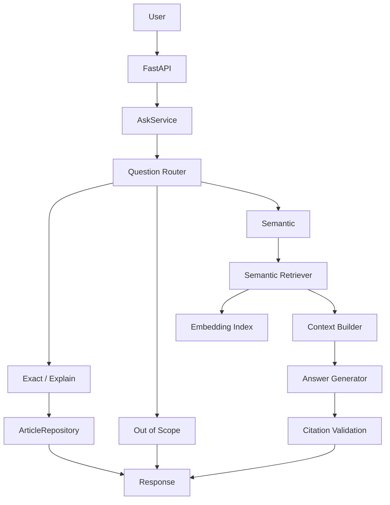
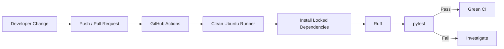

# Egyptian Civil Code RAG — MLOps Practice Project

A bilingual Arabic/English Retrieval-Augmented Generation (RAG) MVP built over a frozen subset of the Egyptian Civil Code.

The main goal of this repository is **MLOps practice**: showing how an ML/GenAI application moves from a local prototype toward a system that is structured, reproducible, tested, versioned, containerized, experiment-tracked, and automatically validated in CI.

> **Legal disclaimer:** This is an educational project, not legal advice. The corpus is incomplete and does not establish current legal status, authoritative transcription, or complete coverage of Egyptian law.

---

## 1. What This Project Demonstrates

```text
Code
  ↓
Reproducible Environment
  ↓
Testing + Code Quality
  ↓
Data / Artifact Versioning
  ↓
Experiment Tracking
  ↓
Model Registry Practice
  ↓
API Serving
  ↓
Containerization
  ↓
Continuous Integration
  ↓
Repeatable Delivery
```

The application supports:

- Arabic and English questions
- Exact article lookup
- Explanation of a named article
- Semantic retrieval
- Grounded LLM answers
- Citation validation
- Out-of-scope rejection
- Repealed-article source-note handling
- Language-isolated retrieval

The goal is not to maximize RAG quality at this stage. The goal is to understand how an ML/GenAI system moves toward reliable production operation.

---

## 2. Frozen MVP Scope

| Item | Value |
|---|---:|
| Civil Code articles | 160 |
| Additional promulgation records | 2 |
| Total corpus records | 162 |
| Retrieval/search records | 268 |
| Languages | Arabic + English |
| Repealed range represented by source note | Articles 54–80 |
| Current PDF coverage | Pages 1–18 of 170 |
| Embedding dimension | 384 |

The corpus manifest stores lineage and integrity metadata such as record counts, article coverage, languages, parser version, repealed ranges, and source hashes.

The complete 170-page extraction is intentionally outside the current MLOps scope.

---

## 3. Application Architecture



Package responsibilities:

- `core/` — routing, language detection, scope rules, citation rules
- `repositories/` — frozen corpus access
- `retrieval/` — semantic search and context construction
- `generation/` — OpenAI request handling
- `services/` — business logic through `AskService`
- `api/` — FastAPI routes, validation, schemas, lifecycle, and error mapping
- `pipelines/` — offline parsing, corpus, index, manifest, and evaluation workflows
- `tests/` — unit, API, integration, regression, and integrity coverage

### Lazy heavy-resource initialization

The embedding model, retrieval index, and OpenAI client initialize only when required.

Therefore these paths do not require model loading or an OpenAI key:

- application import
- `/health`
- exact article lookup
- out-of-scope rejection
- repealed-article source-note responses

---

## 4. Project Structure

```text
civil-code-rag-mlops/
│
├── .dvc/
├── .github/
│   └── workflows/
│       └── ci.yml
├── data/
│   ├── processed/
│   ├── index/                  # DVC-managed
│   └── index.dvc
├── eval/
├── pipelines/
├── src/
│   └── civil_code_rag/
│       ├── api/
│       ├── core/
│       ├── generation/
│       ├── repositories/
│       ├── retrieval/
│       ├── services/
│       └── config.py
├── tests/
├── .dockerignore
├── .gitignore
├── Dockerfile
├── pyproject.toml
├── uv.lock
└── README.md
```

---

## 5. Technology Stack

### Application
- Python 3.12
- FastAPI
- Pydantic
- OpenAI Responses API
- Sentence Transformers
- PyTorch CPU
- NumPy

### MLOps / Engineering
- `uv` — dependency and environment management
- Git / GitHub — source-code versioning
- `pytest` — automated testing
- Ruff — linting and code quality
- Docker — application packaging
- Docker Hub — container registry practice
- DVC — retrieval-index artifact versioning
- MLflow — experiment tracking and Model Registry practice
- GitHub Actions — Continuous Integration

---

## 6. Local Setup

Clone:

```bash
git clone https://github.com/MahmoudAmgad88/civil-code-rag-mlops.git
cd civil-code-rag-mlops
```

Install the base environment:

```bash
uv sync --locked
```

Install development and embedding dependencies:

```bash
uv sync --locked --extra dev --extra embeddings
```

Why the lockfile matters:

```text
pyproject.toml → dependency declaration
uv.lock        → exact resolved versions
uv sync --locked → reproducible environment
```

---

## 7. Configuration and Secrets

Semantic/explanation routes that generate text require:

```text
OPENAI_API_KEY
```

PowerShell:

```powershell
$env:OPENAI_API_KEY="your-key"
```

Secrets must be injected at runtime and never committed.

Supported configuration includes:

- `CIVIL_CODE_RAG_CORPUS_PATH`
- `CIVIL_CODE_RAG_INDEX_DIR`
- `CIVIL_CODE_RAG_EMBEDDING_MODEL`
- `CIVIL_CODE_RAG_LLM_MODEL`

OpenAI generation uses `store=False`.

Production deployment should use a managed secret store rather than developer environment variables alone.

---

## 8. Run the API

```bash
uv run --extra embeddings uvicorn civil_code_rag.api.main:app --host 127.0.0.1 --port 8000
```

Health:

```bash
curl http://127.0.0.1:8000/health
```

Exact article example:

```bash
curl -X POST http://127.0.0.1:8000/ask   -H "Content-Type: application/json"   -d '{"question":"What does Article 91 say?"}'
```

| Question type | Behavior | Embedding? | OpenAI? |
|---|---|---:|---:|
| Health | health check | No | No |
| Exact article | direct corpus lookup | No | No |
| Repealed article | source note | No | No |
| Explicit out of scope | reject | No | No |
| Explain named article | article + generation | No semantic retrieval | Yes |
| Semantic question | retrieve + context + generate | Yes | Yes |

---

## 9. Testing Strategy

The project uses multiple testing levels:

```text
Unit Tests
  ↓
API / Contract Tests
  ↓
Integration Tests
  ↓
Runtime Integrity Tests
  ↓
Manual E2E Smoke Test
```

Run all tests:

```bash
uv run --extra dev --extra embeddings python -m pytest tests -q
```

Run Ruff:

```bash
uv run --extra dev ruff check .
```

### Current integration coverage

`test_api.py` exercises:

```text
HTTP Request
→ FastAPI
→ AskService
→ Real ArticleRepository
→ Frozen Corpus
```

while expensive/external dependencies are controlled with mocks where appropriate.

`test_context_builder_integration.py` exercises:

```text
Real Corpus
→ ArticleRepository
→ Context Builder
```

`test_answer_generator_integration.py` validates the OpenAI request contract using a fake client, so no network call is required.

### Manual E2E smoke path

```text
FastAPI
→ Retriever
→ Embedding Model
→ DVC-managed Index
→ Context Builder
→ OpenAI
→ Citation Validation
→ Final Response
```

This gives a practical distinction:

- **Unit test** — one isolated component
- **Integration test** — multiple real components working together
- **E2E test** — the complete user path including runtime/external dependencies

---

## 10. Offline Data and Index Pipelines

Run from the repository root when intentionally rebuilding artifacts:

```bash
uv run python -m pipelines.parse_arabic
uv run python -m pipelines.parse_english
uv run python -m pipelines.pair_articles
uv run python -m pipelines.validate_corpus
uv run python -m pipelines.build_search_records
uv run --extra embeddings python -m pipelines.check_token_lengths
uv run --extra embeddings python -m pipelines.build_embedding_index
uv run python -m pipelines.build_manifest
uv run --extra embeddings python -m pipelines.evaluate_retrieval
```

Do not rebuild the frozen corpus or index casually.

A data or embedding change should be treated as a versioned MLOps change: rebuild → validate → evaluate → version.

---

## 11. DVC — Artifact Versioning

Git is used for code and small metadata. DVC is used for the generated retrieval index.

```text
Git
  └── data/index.dvc
        ↓
      hash / metadata

DVC Cache
  └── actual index artifact
        ↓
      dvc push

DVC Remote
  └── artifact storage
```

Useful commands:

```bash
dvc status
dvc add data/index
dvc push
dvc pull
```

### Local DVC remote used for practice

A local filesystem remote was configured to practice the full DVC lifecycle without introducing cloud credentials.

The workflow was verified end to end:

```text
dvc add
→ DVC cache
→ dvc push
→ local DVC remote
→ remove local working copy/cache for restore test
→ dvc pull
→ artifact restored
```

The local remote is intentionally excluded from Git.

### Current limitation

GitHub Actions cannot access a DVC remote stored on the developer's machine.

Therefore CI receives:

```text
source code             ✅
data/index.dvc metadata ✅
local DVC artifact      ❌
```

Artifact-dependent integrity tests skip when the actual index is unavailable.

A production next step would be S3, GCS, Azure Blob Storage, or another shared DVC remote, enabling `dvc pull` inside CI.

---

## 12. MLflow — Experiment Tracking

MLflow tracks retrieval evaluation experiments.

Start MLflow:

```bash
uv run --extra dev mlflow server --host 127.0.0.1 --port 5000
```

Run retrieval evaluation:

```bash
uv run --extra dev --extra embeddings python -m pipelines.evaluate_retrieval
```

Tracked information includes:

**Parameters**
- `top_k`
- embedding model
- evaluation dataset
- question count

**Metrics**
- Recall@K
- Mean Reciprocal Rank (MRR)
- mean retrieval latency

**Reproducibility metadata**
- Git commit
- Git dirty status

**Artifacts**
- evaluation summary JSON

The important lesson is that an experiment should connect:

```text
Parameters + Metrics + Artifacts + Source-Code State
```

---

## 13. MLflow Model Registry Practice

The embedding model was registered in MLflow to practice model lifecycle concepts:

```text
Register
→ Version
→ Champion
→ Challenger
→ Promote
→ Rollback
```

The project used the same embedding model during part of this workflow because the goal was to practice lifecycle mechanics.

The concept is:

```text
Versioned model/artifact
→ explicit approved version
→ controlled promotion
→ reversible rollback
```

---

## 14. Docker — Reproducible Packaging

Build:

```bash
docker build -t civil-code-rag:local .
```

The project is CPU-only.

### Docker optimization lesson

An early image reached approximately **18.5 GB** because PyTorch resolved CUDA/NVIDIA dependencies that were unnecessary for this workload.

The dependency configuration was changed to CPU-only PyTorch and the build was improved with cache-aware installation.

The resulting development image was reduced to approximately **1.8 GB**.

The exact size can vary, but the engineering lesson is:

```text
CPU workload
→ CPU-only dependencies
→ smaller image
→ faster transfer/startup
→ lower storage overhead
```

### Runtime separation

The retrieval index is mounted instead of baked into the image, and the Hugging Face cache can live in a Docker volume.

PowerShell example:

```powershell
$indexPath = (Resolve-Path .\data\index).Path

docker run --rm `
  -p 127.0.0.1:8000:8000 `
  --mount "type=bind,source=$indexPath,target=/app/data/index,readonly" `
  --mount "type=volume,source=civil-code-rag-hf-cache,target=/root/.cache/huggingface" `
  --env OPENAI_API_KEY `
  -e HF_HOME=/root/.cache/huggingface `
  civil-code-rag:local
```

The runtime becomes:

```text
Application Image
+ Versioned Index Artifact
+ Runtime Secret
+ Persistent Model Cache
```

A Docker Hub push was also performed to practice the container-registry workflow.

---

## 15. Continuous Integration — GitHub Actions

GitHub Actions provides an automated quality gate:



Typical stages:

```text
Checkout
→ Install Python / uv
→ Install dependencies
→ Ruff
→ pytest
```

### Why CI does not use a live OpenAI key

Normal automated tests use fakes/mocks and avoid real OpenAI calls.

That keeps CI:

- deterministic
- faster
- cheaper
- independent of external API availability
- safer because normal CI does not require an LLM secret

### Why one artifact test can be skipped

The current DVC remote is local-only, so the GitHub runner cannot restore the index.

With a cloud DVC remote, a future workflow could become:

```text
Checkout
→ dvc pull
→ Ruff
→ pytest
→ full artifact integrity validation
```

---

## 16. Git Delivery Workflow

Development is performed on a feature branch and delivered through a pull request:

```text
feature/day1-package-refactor
→ Push
→ Pull Request
→ GitHub Actions
→ Green Checks
→ Merge to main
→ Release Tag
```

Recommended release tag:

```bash
git tag -a v1.0.0 -m "Civil Code RAG MLOps MVP v1.0.0"
git push origin v1.0.0
```

This creates an identifiable release point instead of relying only on the latest commit.

---

## 17. Reproducibility Strategy

Reproducibility is provided by several layers, not one tool.

| Concern | Mechanism |
|---|---|
| Source code | Git commit |
| Python dependencies | `pyproject.toml` + `uv.lock` |
| Corpus lineage | corpus manifest |
| Data integrity | hashes + validation |
| Retrieval index | DVC |
| Experiments | MLflow |
| Experiment source state | Git commit logged in MLflow |
| Runtime packaging | Docker |
| Automated validation | GitHub Actions |
| Release identity | Git tag |

Core principle:

> A result is only useful if we can identify which code, data, configuration, dependencies, and artifact versions produced it.

---

## 18. Security and Reliability Practices

Current practices:

- runtime secret injection
- no hard-coded OpenAI key
- secrets excluded from Git
- OpenAI `store=False`
- Pydantic request validation
- citation validation
- explicit out-of-scope handling
- health endpoint
- read-only Docker index mount
- dependency locking
- frozen corpus validation
- external services mocked during deterministic CI tests

Production improvements:

- managed secret storage
- authentication / authorization
- rate limiting
- audit logging
- image vulnerability scanning
- dependency/security scanning
- stronger legal-data governance

---

## 19. MLOps Concepts Practiced

| Concept | Implementation | Status |
|---|---|---|
| Reproducible environment | `uv`, `pyproject.toml`, `uv.lock` | ✅ Practiced |
| Source versioning | Git / GitHub | ✅ Practiced |
| Package/OOP structure | service/repository/retrieval/generation layers | ✅ Practiced |
| Input validation | Pydantic | ✅ Practiced |
| Model serving | FastAPI | ✅ Practiced |
| Unit testing | pytest | ✅ Practiced |
| Integration testing | FastAPI + services + real corpus | ✅ Practiced |
| Code quality | Ruff | ✅ Practiced |
| Artifact versioning | DVC | ✅ Practiced |
| Artifact restore | local DVC remote + push/pull | ✅ Practiced |
| Experiment tracking | MLflow | ✅ Practiced |
| Model Registry | MLflow | ✅ Practiced |
| Containerization | Docker | ✅ Practiced |
| CPU image optimization | CPU-only PyTorch | ✅ Practiced |
| Container registry | Docker Hub | ✅ Practiced |
| Continuous Integration | GitHub Actions | ✅ Practiced |
| Runtime secrets | environment injection | ✅ Practiced |
| Manual E2E validation | Dockerized semantic path | ✅ Practiced |

---

## 20. Key Engineering Lessons

### Git and DVC solve different problems

```text
Git → code and small metadata
DVC → generated ML/data artifacts
```

### Experiment tracking is more than saving a score

```text
Parameters + Metrics + Artifacts + Git State
```

### Container size matters

Installing GPU libraries in a CPU workload can create huge, unnecessary images.

### CI should be deterministic

Do not make a live external LLM call the default CI gate. Mock that boundary and test full E2E behavior separately.

### Integration tests are not unit tests

Unit tests validate isolated components. Integration tests validate that real components cooperate correctly.

### Reproducibility is end to end

Dependency locking alone does not version the data, index, experiment, container, or release.

---

## 21. Current Limitations / Knowledge Gap Backlog

### Important next steps
- cloud/shared DVC remote
- larger RAG evaluation dataset
- production secret manager
- automated full E2E environment
- monitoring and observability
- retrieval/data drift monitoring
- production deployment strategy

### Future / advanced topics
- Kubernetes
- automated re-indexing / retraining
- full 170-page Civil Code extraction
- advanced RAG evaluation
- security hardening
- infrastructure as code
- image vulnerability scanning
- optional W&B comparison with MLflow

---

## 22. How to Explain This Project

A concise interview / knowledge-sharing story:

> I started with a bilingual Egyptian Civil Code RAG MVP. Instead of first optimizing the RAG model, I used it as a stable application to practice MLOps.
>
> I refactored it into a package with clear API, service, repository, retrieval, and generation layers. I used `uv` and a lockfile for reproducible Python dependencies.
>
> I added unit, API-contract, integration, regression, and runtime-integrity testing, with Ruff as a code-quality gate. External OpenAI calls are mocked in automated tests so CI stays deterministic.
>
> The frozen corpus has lineage/integrity metadata, while the embedding index is versioned with DVC. I configured a local DVC remote and practiced the full `add → push → pull → restore` lifecycle.
>
> I used MLflow to track retrieval experiments such as Recall@K, MRR, latency, parameters, and Git state. I also practiced Model Registry concepts with champion/challenger promotion and rollback.
>
> I containerized the application with Docker. An early image accidentally included GPU/CUDA dependencies and grew to about 18.5 GB, so I moved to CPU-only PyTorch and reduced it to about 1.8 GB.
>
> Finally, I added GitHub Actions so pushes and pull requests run code-quality checks and tests on a clean runner. The delivery flow is feature branch → pull request → CI → main → release tag.
>
> The main production gaps I would address next are cloud artifact storage, stronger evaluation, production secrets, monitoring, and orchestration.

The central learning goal is:

> **How an ML/GenAI application moves from local development toward a reliable production system.**

---

## 23. MLOps Lifecycle Mapping

```text
Data
  ↓
Frozen corpus + manifest

Experiment
  ↓
Retrieval evaluation

Representation
  ↓
Embedding model + embedding index

Tracking
  ↓
MLflow

Versioning
  ↓
Git + DVC + MLflow Model Registry

Testing
  ↓
pytest + integration tests + Ruff

Packaging
  ↓
Docker

Serving
  ↓
FastAPI

Continuous Integration
  ↓
GitHub Actions

Delivery
  ↓
Pull Request + main + release tag

Monitoring
  ↓
Future work

Drift / Re-indexing / Retraining
  ↓
Future work
```

---

## 24. Final Project Boundary

Completed scope:

```text
RAG MVP
→ Package Refactor
→ Reproducible Environment
→ Frozen / Validated Data
→ Automated Testing
→ Artifact Versioning
→ Experiment Tracking
→ Model Registry Practice
→ Docker Packaging
→ Container Registry
→ CI
→ Versioned Delivery
```

Next production phase:

```text
Cloud Artifact Storage
→ Deployment Platform
→ Monitoring
→ Drift Detection
→ Automated Re-indexing / Retraining
→ Governance
```

---

## Author

**Mahmoud ElSalakawy**

MLOps / Data Science / Generative AI practical learning project.
